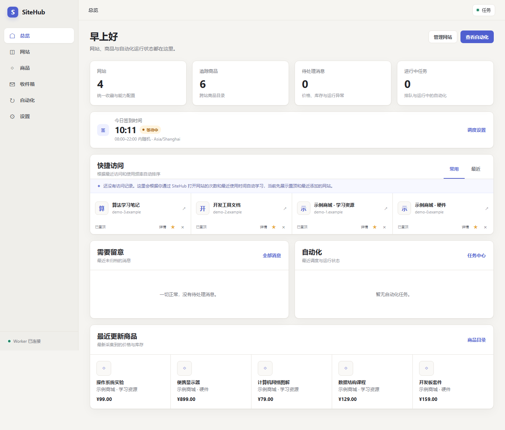
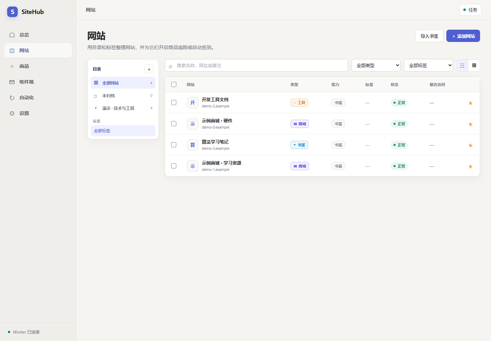
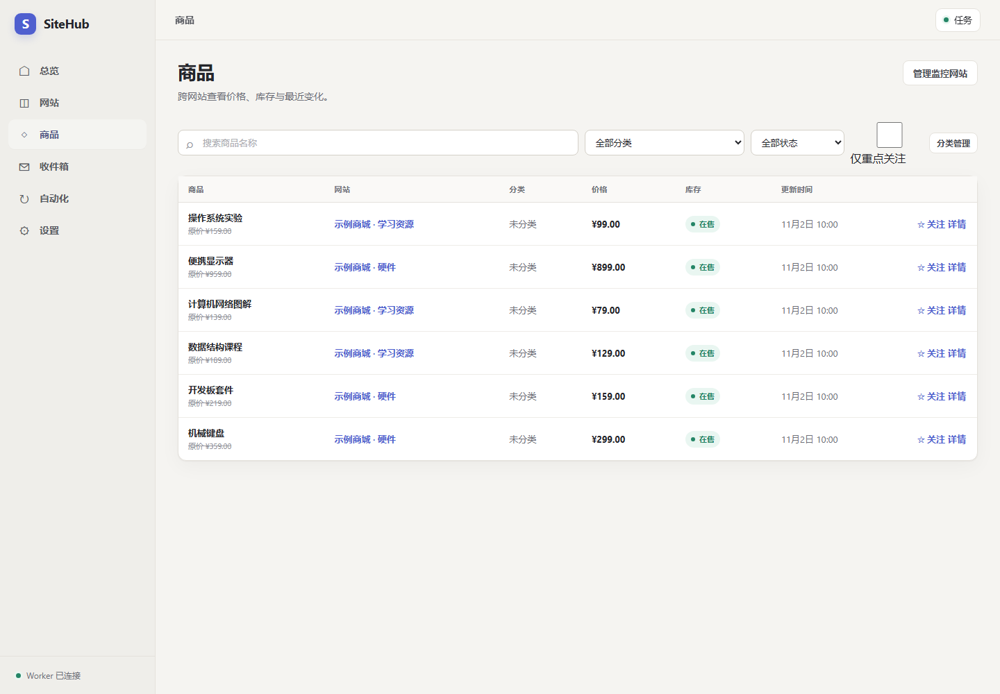
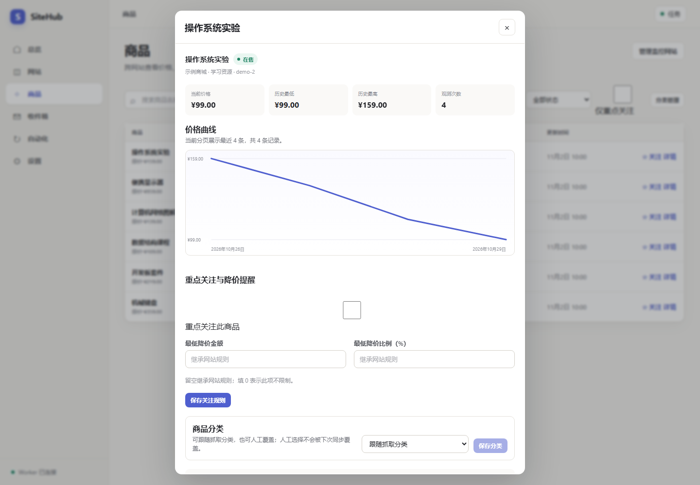
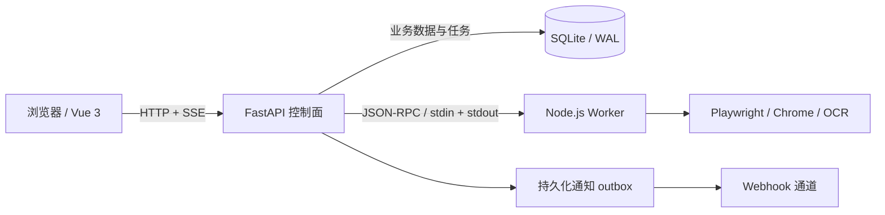

# SiteHub

**把网站收藏、商品监控和多账号签到集中到一个本地工作台。**

SiteHub 是面向 Windows 本机单用户的网站管理与自动化工具：通过目录和标签整理网站，查看商品价格与库存变化，安排签到，并在统一界面追踪任务、处理消息和维护数据。

技术栈：**Vue 3 · TypeScript · FastAPI · SQLite · Node.js · Playwright**。

[快速启动](#快速启动) · [架构设计](docs/architecture.md) · [测试与验收](docs/testing.md) · [运行与维护](docs/operations.md)

## 能做什么

| 功能 | 使用方式 |
| --- | --- |
| 网站整理 | 目录树、主类型、多标签、书签导入，以及置顶、常用和最近访问 |
| 商品监控 | 跨站商品列表、站内分类、价格历史、降价阈值、库存变化确认与异常目录保护 |
| 多账号签到 | API、Cookie、通用浏览器与专用站点适配器；独立账号 Profile、登录验证和签到计划 |
| 自动化管理 | 查看任务与运行记录，追踪进度、取消或重试任务，处理执行结果不确定的情况 |
| 消息通知 | 站内收件箱与多个 Webhook 通道，按事件类型和级别筛选，失败后有限重试 |
| 数据维护 | 一致性备份、完整性校验、下次启动恢复、定时备份与可选历史保留策略 |

商品抓取与签到需要配置对应适配器和账号，不支持任意网站自动适配。

## 界面预览

以下截图来自本机隔离实例，使用虚构网站、商品和价格历史，不包含真实账号或日常业务数据。



<details>
<summary>查看网站管理、商品列表与价格历史</summary>







</details>

## 快速启动

环境要求：**64 位 Windows、Python 3.11–3.13、Node.js 20.19+ 或 22.12+**。首次准备依赖需要联网。

```powershell
git clone https://github.com/cquwf53/site-hub.git
cd site-hub
.\start.bat
```

启动器会创建 Python 虚拟环境、安装锁定依赖与 Playwright Chromium、构建前端，并在服务完整就绪后打开浏览器。正式运行入口为 **http://127.0.0.1:8686**，由 FastAPI 同时提供页面和 API。

首次使用建议：

1. 在“网站”中添加网站，设置目录、类型和标签。
2. 需要监控商品时，配置对应抓取器与同步周期；手工目录不会自动抓取。
3. 需要签到时，添加账号并配置适配器；浏览器账号先完成登录和 Profile 验证。
4. 在“自动化”中查看运行结果，在“收件箱”中处理变化与异常。
5. 在“设置 → 数据”中创建并校验一份备份。

默认数据保存在 `data/`，已通过 `.gitignore` 排除。数据库、浏览器 Profile、截图和日志应保留在本地；数据库备份不包含 Profile、截图或日志。停止、登录启动、备份恢复与迁移步骤见[运行与维护](docs/operations.md)。

## 架构与关键实现



一个业务端口对应多个受监管进程：Python 负责业务数据与调度，Node Worker 不直接访问业务数据库，也不监听业务端口。部分 Chrome 适配器运行时使用临时回环 CDP 端口。

| 工程问题 | 当前实现 | 代码入口 |
| --- | --- | --- |
| 进程中断后的任务处理 | SQLite 持久化队列、租约 Token、心跳与过期恢复；签到按账号和上海业务日期去重 | [任务服务](site_hub/jobs/service.py)、[任务存储](site_hub/services/store_jobs.py) |
| 浏览器任务影响主服务 | Worker 握手、超时、重启及 Windows 子进程清理；登录、验证、签到共享 Profile 所有权约束 | [Worker 监管](site_hub/workers/supervisor.py)、[Profile 锁](worker-node/src/profile-locks.js) |
| 远端操作执行后丢失结果 | 使用 `effect_unknown` 保留不确定性；适配器具备核对能力时先核对远端状态 | [执行与核对](worker-node/src/checkin/runner.js) |
| 抓取抖动引发错误通知 | 降价金额与比例阈值、冷却时间、不同任务的库存确认、商品目录骤降保护 | [监控规则](site_hub/services/product_monitor.py)、[商品同步](site_hub/services/store_products.py) |
| 业务事件与通知可靠投递 | 事件与 outbox 同事务写入，发送租约、超时和有限重试；不承诺外部接收方恰好收到一次 | [通知存储](site_hub/notifications/store.py)、[通知执行器](site_hub/notifications/executor.py) |
| 长任务的页面状态同步 | SSE 加任务快照补拉，避免旧请求覆盖新状态；OpenAPI 生成 DTO 并检查漂移 | [前端任务状态](frontend/src/stores/tasks.ts)、[类型生成器](tools/generate-api-types.py) |
| 升级与恢复的数据保护 | SQLite Backup API、SHA-256 与完整性校验、升级前快照、启动时恢复及失败回滚 | [备份恢复](site_hub/services/backups.py)、[启动生命周期](site_hub/main.py) |

完整的组件职责、故障语义和数据边界见[架构说明](docs/architecture.md)。

## 开发与验证

项目采用 npm workspaces，前端和 Worker 共用根目录锁文件。

```powershell
# 完整 Windows 验收：依赖、测试、类型、构建、启动与清理
powershell -NoProfile -ExecutionPolicy Bypass -File tools\verify.ps1
```

完整验收要求 `8686` 空闲。已有服务运行时，请使用[测试说明](docs/testing.md)中的隔离验收流程。

依赖已经安装时，可分别执行：

```powershell
.\.venv\Scripts\python.exe -m pytest -q -m "not integration and not profile"
npm.cmd test
npm.cmd run typecheck
npm.cmd run api:check
```

常规 Python 测试另需 `requirements-dev.lock` 中的开发依赖。真实账号、站点可用性和旧 Profile 迁移需要单独验收；测试通过不代表所有外部站点持续可用。

2026-11-02 本机复验：**232 项 Python、78 项前端、66 项 Worker 测试通过**，前端类型检查及生产构建、OpenAPI DTO 漂移检查、Python 依赖一致性检查通过。隔离 Windows / 浏览器验收也通过，包括 Worker 故障恢复与退出清理。环境与验证边界见[项目检查记录](docs/project-review.md)。

## 项目结构

```text
site_hub/       FastAPI、SQLite、任务调度、商品监控、通知与 Worker 监管
frontend/       Vue 3、TypeScript、Pinia、Vue Router 与 Vitest 测试
worker-node/    JSON-RPC Worker、签到适配器与浏览器资源管理
tests/          Python 单元与集成测试
tools/          类型生成、Windows 验收、生命周期管理与旧数据迁移
docs/           架构、测试、运行维护与迁移文档
```

## 使用边界与来源

当前生产实现面向 Windows 本机单用户，固定监听回环地址，不提供公网部署或多用户权限管理。敏感配置使用 Windows DPAPI CurrentUser 加密；本机写请求有 Host、Origin 与 CSRF 校验。DPAPI 密文不能直接跨 Windows 用户迁移。

SiteHub 是个人主导、借助 Codex 与 Zcode 进行 AI 辅助开发的项目。开发方式与旧系统整合记录见[开发说明](docs/provenance.md)。仓库目前未提供项目级 LICENSE，第三方依赖遵循各自许可证。

## 文档导航

- [架构设计](docs/architecture.md)：运行拓扑、组件职责、数据边界与故障处理。
- [测试与验收](docs/testing.md)：Python、前端、Worker 测试及隔离浏览器验收。
- [运行与维护](docs/operations.md)：启动停止、账号调度、通知、备份恢复与历史保留。
- [旧数据迁移](docs/legacy-migration.md)：分析、演练、导入与恢复边界。
- [切换检查](docs/cutover.md)：旧系统切换前后的操作要求。
- [开发说明](docs/provenance.md)：AI 辅助开发方式、项目演进与依赖授权。
- [项目检查记录](docs/project-review.md)：本次实测结果、技术阅读入口与后续整理优先级。
