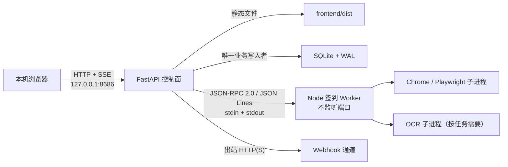

# SiteHub 架构说明

## 运行拓扑

SiteHub 的“单端口”是网络边界，不是“只有一个操作系统进程”。

FastAPI 是根服务进程和控制面，固定监听 `127.0.0.1:8686`，同时提供 Vue 构建产物与 `/api/v1`。生产环境不启动 Vite。Node Worker、Chrome 和 OCR 均位于受监管进程树中，不对外开放业务服务器端口。少数专用适配器保留了 CDP：任务运行期间 Chrome 会临时绑定一个仅限 `127.0.0.1` 的随机调试端口，任务关闭时必须释放。

## 组件职责

### Python 控制面

`site_hub/` 负责：

- 初始化版本化 SQLite 数据库并作为唯一业务写入者；
- 提供网站、目录、标签、商品、签到账号、计划、任务、事件、通知和产物 API；
- 通过站点级受控打开入口记录聚合使用次数，并生成总览的常用/最近网站排序；
- 运行持久化任务队列、商品抓取调度、签到批次和系统任务；
- 按持久化计划创建数据库备份，并在操作者启用保留策略后清理受控历史数据；
- 监管 Node Worker 的握手、心跳、超时、重启和关闭；
- 通过 SSE 推送任务变化；
- 托管 `frontend/dist`，并为前端路由回退到 `index.html`。

任务状态和运行记录保存在数据库中。书签导入、登录会话和适配器测试也进入持久化系统任务，不依赖页面内存中的临时任务。

`DataLayerStore` 保持统一 Store 接口，业务实现拆为 `store_sites`、`store_accounts`、`store_products`、`store_jobs`、`store_schedules`、`store_activity` 六个模块，仍共享相同的 SQLite 连接工厂、事务和秘密服务。

### Node Worker

`worker-node/` 保留签到适配器、登录会话、Chrome Profile、CDP 和 OCR 能力。Worker 一次执行一个签到或登录类任务：

- 标准输出只用于 JSON Lines 协议，普通日志写标准错误；
- 不监听 HTTP/TCP 端口；
- 不直接打开或修改 SiteHub SQLite 数据库；
- 截图以受控相对路径、大小和 SHA-256 元数据回传，不在协议中传 Base64；
- 收到关闭或任务取消时清理其拥有的浏览器/OCR 资源。

这里的“不监听”指 Worker 进程本身；受它监管的 Chrome 在 CDP 任务期间存在上述临时回环调试监听。

Windows 下监管器使用进程树约束辅助清理。即使 Worker 被异常终止，FastAPI 页面和商品 API 仍可工作，监管器会按策略尝试恢复 Worker。

### Vue 前端

`frontend/` 是 Vue 3 + TypeScript 单页应用，主要覆盖概览、网站目录树、商品、签到账号、任务/运行历史、收件箱和设置。总览快捷访问通过 `/overview/sites` 读取聚合偏好；真正访问网站必须调用 `/sites/{id}/open`，不能在页面中解密或直接拼接敏感 URL。浏览器写请求携带从 `/api/v1/bootstrap` 获取的随机 CSRF Token；长任务以任务 ID 跟踪。SSE 连接建立或断开时均补拉任务快照，连接健康时也保留低频快照轮询；过时的请求结果不能覆盖较新的事件或终态，显式重试会隔离上一轮执行的残留事件。

声明在 FastAPI OpenAPI 中的请求/响应模型生成前端 `api/generated.ts` DTO；`api:check` 与统一验收检测类型漂移，接口调整需同步重新生成。

### 通知

业务事件与 `notification_outbox` 可在同一 SQLite 事务中写入。后台执行器租约领取待发送项，并进行有限重试。禁用通道会取消其待发送或已租约项；最终失败会生成可处理事件，但失败事件本身不会再次触发通知。

Webhook 地址存放在 `secrets` 表的 DPAPI CurrentUser 密文中。通道列表只返回 `endpoint_configured`，不返回端点。传输错误持久化为稳定错误码，避免把 URL、查询 Token 或响应正文写入普通日志与事件。

## 数据边界

默认数据目录为 `data/`，可通过 `SITEHUB_DATA_DIR` 指向另一个明确目录。关键内容包括：

- `site-hub.db`：SQLite 主库，启用 WAL 和外键；
- `browser-profiles/<account UUID>/`：账号浏览器数据；
- `artifacts/`：任务产物，必须通过受控 API 访问；
- `staging/`：书签导入等系统任务的受控暂存；
- `logs/`：服务日志。

网站使用一个受控主类型、一个树状目录和多个标签共同整理；`site_types` 与兼容字段 `sites.kind` 由数据库约束保持同步。网站目录、网站类型和商品分类是彼此独立的领域。同一域名可存在多个业务网站，同一网站可有多个签到账号。URL 的查询参数/fragment、Cookie、Token、Authorization 和 Webhook 地址不进入普通配置或公共响应。

站点使用偏好只保存在 `sites.visit_count`、`sites.last_visited_at` 与 `sites.overview_hidden` 中。计数发生在系统浏览器成功受理站点级打开请求之后；通用 endpoint（例如商品链接）、详情页浏览和后台自动化不会计数。常用排序使用手动置顶和带 30 天半衰期的频率分，最近排序只包含真实访问记录。点击不写入 `events`，也不保存逐次访问流水、完整敏感 URL、来源页、IP 或 User-Agent。

## 调度与故障语义

- 默认签到使用 `Asia/Shanghai` 业务日期和每日随机窗口；账号覆盖可选择固定时间或自定义窗口；签到队列保持单并发。
- 商品抓取默认周期为 60 分钟；同一网站的商品任务串行领取，不同网站仍可使用 Python 控制面的 3 个并发槽位。
- 商品监控支持关注规则、降价金额/比例阈值和冷却时间；库存变化需不同成功任务确认，未知库存不能作为补货证据。目录数量骤降或错误页面触发缩水保护时保留原目录并产生 `catalog_anomaly` 事件。
- 持久化任务通过租约恢复进程中断；基础设施失败与业务失败使用不同原因码。
- 远端效果不确定时使用 `effect_unknown`，签到适配器应先核对当日状态，不能把未知结果当成安全重试许可。
- 通知、浏览器、网络和 OCR 操作均有超时/取消边界；停止根服务时先停止调度并通知 outbox 退出，等待维护和任务分发器结束，再关闭 Worker 并等待通知执行器退出，最后释放数据库实例锁。

## 本机安全模型

第一版是 Windows 本机单用户系统，不提供公网、多用户账号或登录权限：

- 监听地址和端口固定为 `127.0.0.1:8686`；
- Host 仅允许回环地址，不启用跨域访问；
- 浏览器写操作必须通过 CSRF 校验；
- 目标 URL 只允许 HTTP/HTTPS；
- 敏感值使用 Windows DPAPI CurrentUser，无明文或非 Windows 生产降级；
- 第二个使用同一数据目录的 SiteHub 实例会被单实例锁拒绝。

这些限制不能替代 Windows 用户账户和磁盘权限。备份数据库、Profile 或迁移快照时，仍应按敏感数据处理。

## 启动与关闭

`start.bat` 调用 `start.ps1`：准备隔离 Python 环境、安装依赖与浏览器运行时、构建前端，然后以前台方式运行 FastAPI。浏览器只在 `/api/v1/health/ready` 就绪后打开。设置 `SITEHUB_NO_BROWSER=1` 可跳过自动打开；已确认构建产物有效时可设置 `SITEHUB_SKIP_BUILD=1` 跳过本次前端构建。

登录启动属于可选运维动作，`tools/install-startup.ps1` 不会由普通启动或迁移自动调用。注册任务固定在任务计划程序根目录，必须只有一个 action：由当前 Windows 用户执行系统 `wscript.exe`，参数精确指向本项目 `tools/start-hidden.vbs`。任务允许在电池供电时启动且不会因切换到电池而停止，长任务不受默认三天执行时限影响，同时以 `IgnoreNew` 拒绝重叠实例。

`tools/stop-sitehub.ps1` 在更改状态前完成所有权审计。它只停止上述精确匹配的运行任务，或者路径精确为本项目 `.venv\Scripts\python.exe`、命令行为 `-m site_hub.main` 的 8686 owner；随后按已验证的进程血缘检查 Node、Chrome/Playwright 和 OCR 子进程，并确认 8686 已释放。`-AuditOnly` 仅输出审计结论。发现同名外部任务、不可读取的进程身份或非本项目 owner 时会在停止动作前失败；`-Force` 只允许忽略外部同名任务，不扩大可停止进程范围。

隐藏登录启动也遵守 `SITEHUB_DATA_DIR`，启动日志写入该数据目录下的 `logs/startup.log`；相对数据路径以项目根目录为基准。

`tools/uninstall-startup.ps1` 只移除 action、任务目录和当前用户均匹配的 SiteHub 启动任务，不负责停止运行实例，也不负责旧项目调度。正确顺序是先运行停止脚本并确认通过，再移除任务。

## 维护与保留

`services/maintenance.py` 在 SQLite settings 中保存配置和执行时间，默认每 24 小时自动备份，保留清理默认关闭。维护与其他数据库写入通过 SQLite Backup API 和短事务协调，单次维护不可重入；关闭服务时必须等待维护线程完成后再释放数据目录实例锁。

每次保留清理前先生成并完整校验新快照。备份服务的恢复互斥保护整个清理阶段，待恢复请求会暂停清理。自动备份数量策略不会删除手动备份和 pre_restore 回滚点。截图仅删除大小/哈希匹配、任务已结束且超过期限的受控文件；日志归档使用 Windows 独占打开检查防止清理活动文件；每个商品的最新价格观察始终保留。数据库升级到第 5 版增加商品监控规则和状态，回退必须配套恢复旧版本快照。

常规启动在没有执行待恢复请求、已有数据库的版本满足 `0 < user_version < SCHEMA_VERSION` 时，先创建标签为 `Before schema upgrade <旧版本> -> <新版本>` 的一致性备份，校验成功后才执行迁移。该快照归类为手动备份，不受自动备份数量策略清理。待恢复路径沿用自己的 pre_restore 回滚点；恢复到旧版代码仍需同时恢复相应版本数据库。

隔离浏览器验收由 `tools/smoke-isolated.py` 构造仅用于测试的运行实例：它读取独立前端构建目录，在临时数据目录和单独的回环端口运行，并拒绝使用正式 8686 端口。该工具不改变 `start.bat` 的生产网络边界；执行与进程清理结果保存在临时报告中。
